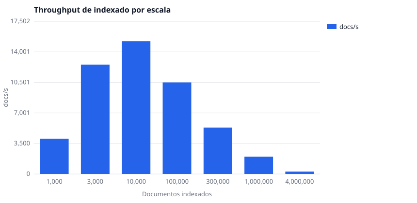
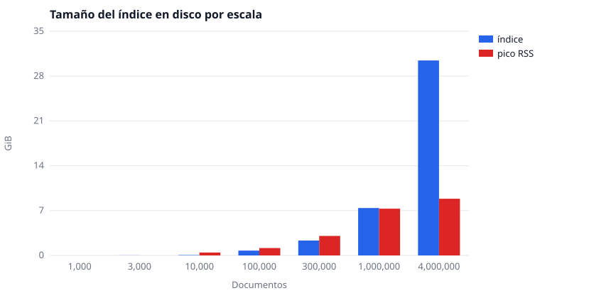
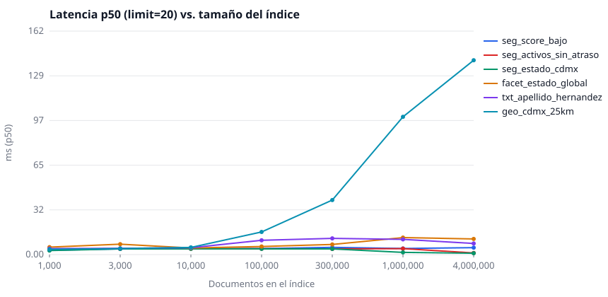
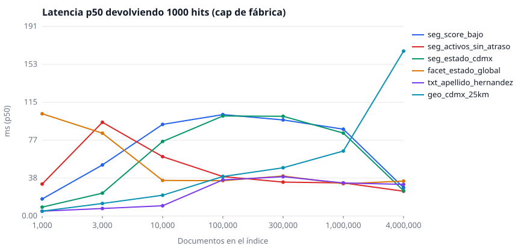
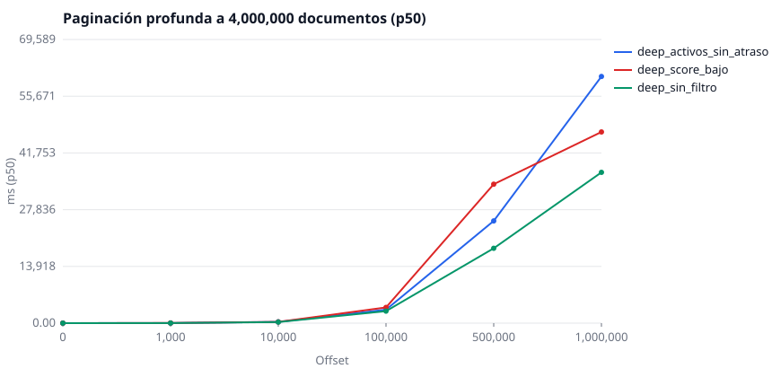
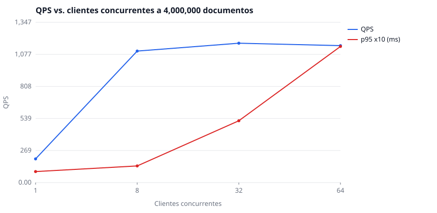

# Laboratorio de estrés con Meilisearch — segmentación de 4,000,000 de clientes ficticios (simulación fintech)

- Motor: **Meilisearch v1.55.0** (binario oficial, `--env production`)
- Host: `AMD Ryzen 5 8645HS w/ Radeon 760M Graphics` — 12 vCPU, 13.4 GiB RAM, kernel 7.1.6-1-cachyos-deckify
- Dataset: **4,000,000 documentos** sintéticos, semilla fija `20261013` (100% ficticios, reproducible bit a bit)
- Índice: `clientes_fintech` — 51 campos por documento, 27 consultas de segmentación + paginación profunda

> Toda cifra de latencia es **cliente** (HTTP completo, incluye serialización y transferencia); `meili_ms` es el `processingTimeMs` que reporta el propio motor.

## 0. Resumen ejecutivo

1. **4,000,000 clientes ficticios caben en Meilisearch en un solo nodo**: índice de 30.02 GiB en disco, 3.9 h de indexado a 284 docs/s promedio, pico de RAM 8.72 GiB.
2. **El conteo de un segmento es exacto y barato**: `estimatedTotalHits` coincide con el ground truth en las 27 consultas × 7 escalas, con p50 de 11.29 ms para faceter los 4,000,000 y de 5.18 ms para filtrar un segmento de 1,045,773 clientes.
3. **Lo que duele es extraer**: con el tope de fábrica (`maxTotalHits=1000`) pedir más devuelve 1000 hits o vacío *sin error*; con el tope levantado, la paginación profunda cuesta segundos (offset 1,000,000 ≈ 36,997 ms p50 a 4,000,000).
4. **26 de las 27 consultas devuelven más de 1000 clientes a 4,000,000** — la segmentación masiva es la norma, no la excepción.
5. **La búsqueda filtrada escala plano**: de 1,000 a 4,000,000 documentos las consultas `limit=20` se mantienen en pocos milisegundos; el volumen se paga al indexar y al paginar profundo.

## 1. Carga e indexado por escala

| Escala | Documentos indexados | NDJSON | Índice en disco | KiB/doc | Tiempo indexado | docs/s | Pico RSS | CPU media |
|---:|---:|---:|---:|---:|---:|---:|---:|---:|
| 1,000 | 1,000 | 0.00 GiB | 0.01 GiB | 5.6 | 0.25 s | 4,047 | — | —% |
| 3,000 | 3,000 | 0.00 GiB | 0.02 GiB | 5.7 | 0.24 s | 12,534 | — | —% |
| 10,000 | 10,000 | 0.01 GiB | 0.05 GiB | 5.6 | 0.66 s | 15,219 | 0.44 GiB | —% |
| 100,000 | 100,000 | 0.12 GiB | 0.74 GiB | 7.8 | 9.53 s | 10,497 | 1.14 GiB | 325% |
| 300,000 | 300,000 | 0.37 GiB | 2.30 GiB | 8.0 | 56.34 s | 5,324 | 3.01 GiB | 232% |
| 1,000,000 | 1,000,000 | 1.24 GiB | 7.30 GiB | 7.7 | 502.39 s | 1,990 | 7.20 GiB | 167% |
| 4,000,000 | 4,000,000 | 4.98 GiB | 30.02 GiB | 7.9 | 14,073.62 s | 284 | 8.72 GiB | 111% |

Faltantes de documentos al indexar: 1,000→1,000, 3,000→3,000, 10,000→10,000, 100,000→100,000, 300,000→300,000, 1,000,000→1,000,000, 4,000,000→4,000,000 (debe coincidir exactamente con la escala).

## 1b. Cómo se construyó este dataset (procedencia y diseño)

**Procedencia.** El esquema de datos está inventado para este laboratorio. No se consultó, raspó ni copió el esquema real de ninguna empresa: los nombres de producto, las bandas, los canales y los estatus son vocabulario genérico del crédito al consumo en México. Los pesos, las correlaciones y las reglas de derivación se escribieron a mano en `gen/spec.py`; las únicas referencias externas son de sentido común (peso poblacional relativo de los estados, orden de magnitud de los ingresos por banda). Toda cifra de este reporte se mide contra *este* dataset, no contra una cartera real.

**El esquema lo dictaron los experimentos.** Cada campo tenía que cumplir cuatro cosas:

1. ser plausible para una fintech de préstamos, para que un analista lea los segmentos sin ruido;
2. ser **filtrable, ordenable o buscable**, porque cada atributo filtrable construye su propia base de facetas — de ahí el costo de 8,059 B por documento y los 30.02 GiB de índice para 4 millones;
3. ser **calculable en forma cerrada sobre vectores** (numpy), requisito para poder predecir el conteo exacto *antes* de consultar;
4. tener cardinalidad variada: 32 estados, 5 productos, 4 bandas de riesgo, 12 etiquetas → facetas grandes y chicas en el mismo índice.

**Pesos declarados** (extracto de `gen/spec.py`; el resto son 32 estados, 12 etiquetas y 8 dominios de correo):

| Campo | Valores y pesos |
|---|---|
| `genero` | H 48%, M 50%, X 2% |
| `producto` | credito_personal 30%, credito_nomina 22%, credito_express 28%, linea_credito 12%, seguro 8% |
| `kyc_status` | verificado 58%, pendiente 22%, rechazado 9%, no_iniciado 11% |
| `estatus_cuenta` | activo 42%, moroso 18%, pagado 24%, cancelado 10%, bloqueado 6% |
| `canal_adquisicion` | referido 21%, facebook 24%, google_ads 17%, tiktok 15%, organico 11%, appstore 7%, prensa 5% |
| `dispositivo` | android 71%, ios 19%, web 10% |
| `banda_riesgo` | bajo 38%, medio 34%, alto 22%, muy_alto 6% |
| `banda_ingreso` | A 30%, B 32%, C 24%, D 10%, E 4% |
| `tipo_vivienda` | propia 28%, rentada 41%, familiar 27%, hipoteca 4% |
| `nivel_educativo` | basica 18%, media 34%, superior 40%, posgrado 8% |
| `tipo_contrato` | formal 46%, informal 27%, independiente 19%, desempleado 8% |
| `segmento_comercial` | nuevo 34%, recurrente 40%, vip 9%, inactivo 17% |

**Correlaciones deliberadas** (lo que hace que los filtros crucen de forma no trivial):

| Relación | Regla |
|---|---|
| `banda_riesgo = bajo` → `score_buro` | N(718, 58) recortada a 300–850 |
| `banda_riesgo = medio` → `score_buro` | N(622, 55) recortada a 300–850 |
| `banda_riesgo = alto` → `score_buro` | N(521, 50) recortada a 300–850 |
| `banda_riesgo = muy_alto` → `score_buro` | N(432, 45) recortada a 300–850 |
| `banda_ingreso = A` → `ingreso_mensual` | N(6,800, 2100) recortada a 2,400–400,000 |
| `banda_ingreso = B` → `ingreso_mensual` | N(11,800, 3100) recortada a 2,400–400,000 |
| `banda_ingreso = C` → `ingreso_mensual` | N(21,500, 6200) recortada a 2,400–400,000 |
| `banda_ingreso = D` → `ingreso_mensual` | N(41,000, 12000) recortada a 2,400–400,000 |
| `banda_ingreso = E` → `ingreso_mensual` | N(74,000, 26000) recortada a 2,400–400,000 |
| `monto_solicitado` | log-normal exp(N(9.1, 0.85)) recortada a 500–80,000 |
| `dias_atraso` | 72 % en 0 + cola exponencial exp(N(3.4, 1.15)) hasta 400 |
| `num_prestamos` | Poisson(3.2) recortada a 0–30 |
| `fecha_registro` / `ultimo_acceso` | uniforme en 3 años / registro + exponencial |

**Campos derivados** (coherentes entre sí, no sorteados por separado):

- `curp` = 2 letras del apellido + 1 del nombre + 1 del segundo apellido + fecha de nacimiento + sexo + código del estado + 3 consonantes internas + 4 hex del PRNG; `rfc` igual con 6 hex.
- `email` = `{nombre}.{apellido}{4 dígitos}@{dominio}`, de modo que el token del correo coincide siempre con el nombre del documento (por eso el conteo por correo es verificable).
- `cp` = prefijo del estado + 3 dígitos; `_geo` = capital del estado + jitter gaussiano σ = 0.22° (≈25 km); `direccion` = calle + número + colonia.
- `nombre_completo`, `utilizacion_pct` y las fechas ISO se calculan de los campos anteriores.

**Cómo queda el dataset** (proporciones medidas sobre los 4 millones, todas verificadas contra el ground truth):

| Segmento | Clientes | Proporción |
|---|---:|---:|
| `score_buro < 520` | 705,801 | 17.65% |
| vive en Ciudad de Mexico | 277,491 | 6.94% |
| KYC verificado de 25 a 35 anios | 1,045,773 | 26.14% |
| activo y sin atraso | 1,209,374 | 30.23% |
| dentro de 25 km del Zocalo | 144,119 | 3.60% |
| apellido Hernandez | 78,428 | 1.96% |

**Qué no es.** Un dataset estacionario y sintético: sirve para medir degradación con un oráculo exacto, no para inferir nada del negocio. Cambiar cualquier tabla de `gen/spec.py` y volver a correr los scripts del README regenera todo — incluido el ground truth — de forma determinista.

## 2. Ground truth: cuánto *debe* devolver cada segmento (calculado antes de consultar)

Los conteos se derivaron de los arreglos que generaron los documentos (numpy), nunca de Meilisearch; por eso sirven como oráculo de correctitud.

| Consulta | Tipo | 1,000 | 3,000 | 10,000 | 100,000 | 300,000 | 1,000,000 | 4,000,000 |
|---|---|---:|---:|---:|---:|---:|---:|---:|
| `seg_estado_cdmx` | filter | 73 | 216 | 723 | **6,839** | **20,691** | **69,144** | **277,491** |
| `seg_riesgo_alto_personal` | filter | 59 | 186 | 631 | **6,562** | **19,504** | **65,474** | **262,980** |
| `seg_score_bajo` | filter | 158 | 509 | **1,757** | **17,726** | **52,879** | **176,302** | **705,801** |
| `seg_morosos_30d` | filter | 17 | 54 | 224 | **2,399** | **7,407** | **24,801** | **100,018** |
| `seg_kyc_verif_jovenes` | filter | 256 | 783 | **2,639** | **26,109** | **78,581** | **261,423** | **1,045,773** |
| `seg_jalisco_ingreso_b` | filter | 25 | 80 | 236 | **2,177** | **6,335** | **21,272** | **84,999** |
| `seg_tiktok_android_marketing` | filter | 64 | 185 | 655 | **6,704** | **20,245** | **66,800** | **268,314** |
| `seg_mujeres_30_45_kyc` | filter | 115 | 375 | **1,233** | **12,809** | **38,527** | **128,180** | **512,893** |
| `seg_riesgo_muy_alto` | filter | 50 | 161 | 590 | **5,923** | **17,889** | **59,635** | **239,694** |
| `seg_activos_sin_atraso` | filter | 322 | 927 | **3,066** | **30,421** | **90,673** | **301,621** | **1,209,374** |
| `seg_tag_promo` | filter | 118 | 341 | **1,103** | **11,355** | **33,943** | **113,299** | **453,572** |
| `seg_nomina_vip_alto_monto` | filter | 1 | 2 | 7 | 79 | 230 | 820 | **3,144** |
| `geo_cdmx_25km` | geo | 38 | 115 | 408 | **3,584** | **10,845** | **36,062** | **144,119** |
| `geo_gdl_50km` | geo | 59 | 193 | 600 | **5,905** | **17,611** | **59,237** | **237,606** |
| `txt_apellido_hernandez` | search | 25 | 54 | 208 | **1,943** | **5,775** | **19,375** | **78,428** |
| `txt_nombre_maria` | search | 21 | 54 | 177 | **1,921** | **5,800** | **19,172** | **76,965** |
| `txt_nombre_apellido_jalisco` | search | 0 | 0 | 0 | 0 | 2 | 5 | 20 |
| `txt_apellido_hernandez_riesgo_alto` | search | 7 | 15 | 56 | 441 | **1,267** | **4,221** | **17,300** |
| `txt_prefix_apellido` | search | 9 | 20 | 101 | 973 | **2,855** | **9,710** | **39,327** |
| `txt_colonia_centro` | search | 31 | 82 | 292 | **2,518** | **7,452** | **24,993** | **99,907** |
| `txt_fulltext_default` | search | 35 | 102 | 321 | **3,406** | **10,353** | **34,345** | **137,561** |
| `mix_sort_score_riesgo_alto` | sort | 217 | 676 | **2,216** | **22,092** | **65,879** | **219,774** | **878,755** |
| `mix_sort_ingreso_banda_c` | sort | 218 | 715 | **2,407** | **24,015** | **71,847** | **240,341** | **960,581** |
| `facet_estado_global` | facet | 1,000 | **3,000** | **10,000** | **100,000** | **300,000** | **1,000,000** | **4,000,000** |
| `facet_morosos_producto_riesgo` | facet | 147 | 499 | **1,750** | **17,784** | **54,001** | **179,405** | **718,864** |
| `facet_score_bajo_canal` | facet | 158 | 509 | **1,757** | **17,726** | **52,879** | **176,302** | **705,801** |
| `facet_kyc_pendiente_dispositivo` | facet | 211 | 661 | **2,196** | **21,777** | **65,904** | **220,060** | **880,261** |

En **negritas** los segmentos con más de 1000 resultados reales (subconteo garantizado con `maxTotalHits=1000`).

## 3. Verificación de correctitud: reportado vs ground truth

`default` = `pagination.maxTotalHits: 1000` (valor de fábrica). `raised` = `maxTotalHits` = tamaño de la escala.

- **default (maxTotalHits=1000)**: 189/189 consultas con conteo exacto (0 discrepancias).
- **raised (maxTotalHits=N)**: 189/189 consultas con conteo exacto (0 discrepancias).

`estimatedTotalHits` **no** se recorta con `pagination.maxTotalHits`: en ambos modos devuelve el conteo real del segmento (verificado contra el ground truth en las 7 escalas). Lo que el setting limita es cuántos hits se pueden extraer; el detalle está en la sección 4.3.

### 3.1 Detalle a 4,000,000 documentos

| Consulta | GT | default `estimatedTotalHits` | raised `estimatedTotalHits` | ¿default OK? | ¿raised OK? | facets OK |
|---|---:|---:|---:|---|---|---|
| `seg_estado_cdmx` | 277,491 | 277,491 | 277,491 | sí | sí | — |
| `seg_riesgo_alto_personal` | 262,980 | 262,980 | 262,980 | sí | sí | — |
| `seg_score_bajo` | 705,801 | 705,801 | 705,801 | sí | sí | — |
| `seg_morosos_30d` | 100,018 | 100,018 | 100,018 | sí | sí | — |
| `seg_kyc_verif_jovenes` | 1,045,773 | 1,045,773 | 1,045,773 | sí | sí | — |
| `seg_jalisco_ingreso_b` | 84,999 | 84,999 | 84,999 | sí | sí | — |
| `seg_tiktok_android_marketing` | 268,314 | 268,314 | 268,314 | sí | sí | — |
| `seg_mujeres_30_45_kyc` | 512,893 | 512,893 | 512,893 | sí | sí | — |
| `seg_riesgo_muy_alto` | 239,694 | 239,694 | 239,694 | sí | sí | — |
| `seg_activos_sin_atraso` | 1,209,374 | 1,209,374 | 1,209,374 | sí | sí | — |
| `seg_tag_promo` | 453,572 | 453,572 | 453,572 | sí | sí | — |
| `seg_nomina_vip_alto_monto` | 3,144 | 3,144 | 3,144 | sí | sí | — |
| `geo_cdmx_25km` | 144,119 | 144,119 | 144,119 | sí | sí | — |
| `geo_gdl_50km` | 237,606 | 237,606 | 237,606 | sí | sí | — |
| `txt_apellido_hernandez` | 78,428 | 78,428 | 78,428 | sí | sí | — |
| `txt_nombre_maria` | 76,965 | 76,965 | 76,965 | sí | sí | — |
| `txt_nombre_apellido_jalisco` | 20 | 20 | 20 | sí | sí | — |
| `txt_apellido_hernandez_riesgo_alto` | 17,300 | 17,300 | 17,300 | sí | sí | — |
| `txt_prefix_apellido` | 39,327 | 39,327 | 39,327 | sí | sí | — |
| `txt_colonia_centro` | 99,907 | 99,907 | 99,907 | sí | sí | — |
| `txt_fulltext_default` | 137,561 | 137,561 | 137,561 | sí | sí | — |
| `mix_sort_score_riesgo_alto` | 878,755 | 878,755 | 878,755 | sí | sí | — |
| `mix_sort_ingreso_banda_c` | 960,581 | 960,581 | 960,581 | sí | sí | — |
| `facet_estado_global` | 4,000,000 | 4,000,000 | 4,000,000 | sí | sí | sí |
| `facet_morosos_producto_riesgo` | 718,864 | 718,864 | 718,864 | sí | sí | sí |
| `facet_score_bajo_canal` | 705,801 | 705,801 | 705,801 | sí | sí | sí |
| `facet_kyc_pendiente_dispositivo` | 880,261 | 880,261 | 880,261 | sí | sí | sí |

### 3.2 Segmentación por facetas (conteos exactos, sin límite de 1000)

| Consulta | GT | Facetas vs. ground truth | Buckets devueltos |
|---|---:|---|---|
| `facet_estado_global` | 4,000,000 | idénticas |  |
| `facet_morosos_producto_riesgo` | 718,864 | idénticas |  |
| `facet_score_bajo_canal` | 705,801 | idénticas |  |
| `facet_kyc_pendiente_dispositivo` | 880,261 | idénticas |  |

### 3.3 Verificación de los documentos devueltos

Se piden los 5 `id` más bajos de cada segmento (`sort=id:asc`, `limit=5`) y se comparan contra el ground truth: comprueba que el motor devuelve **los documentos correctos**, no solo el conteo correcto.

| Escala | Segmentos con ids exactos | Total |
|---:|---:|---:|
| 1,000 | 16 | 16 |
| 3,000 | 16 | 16 |
| 10,000 | 16 | 16 |
| 100,000 | 16 | 16 |
| 300,000 | 16 | 16 |
| 1,000,000 | 16 | 16 |
| 4,000,000 | 16 | 16 |

**Triple verificación del ground truth**: 108/108 comparaciones idénticas entre (a) los arreglos numpy que generaron los documentos, (b) un recuento independiente releyendo las 4,000,000 líneas NDJSON y (c) los conteos que reporta Meilisearch.

## 4. Latencia por escala (consultas de segmentación, `limit=20`)

### 4.1 Configuración default (maxTotalHits=1000)

| Consulta | p50 @1,000 | p50 @3,000 | p50 @10,000 | p50 @100,000 | p50 @300,000 | p50 @1,000,000 | p50 @4,000,000 |
|---|---:|---:|---:|---:|---:|---:|---:|
| `seg_estado_cdmx` | 2.89 | 4.09 | 4.15 | 4.12 | 4.10 | 1.56 | 0.95 |
| `seg_riesgo_alto_personal` | 3.68 | 4.15 | 3.99 | 4.25 | 4.16 | 1.75 | 1.14 |
| `seg_score_bajo` | 3.13 | 4.16 | 4.27 | 4.36 | 5.21 | 4.41 | 5.00 |
| `seg_morosos_30d` | 3.82 | 4.01 | 4.18 | 4.40 | 4.65 | 3.95 | 3.16 |
| `seg_kyc_verif_jovenes` | 4.19 | 4.55 | 4.56 | 3.77 | 5.45 | 5.71 | 5.18 |
| `seg_jalisco_ingreso_b` | 3.33 | 4.14 | 4.23 | 3.94 | 4.20 | 4.51 | 1.53 |
| `seg_tiktok_android_marketing` | 4.23 | 3.73 | 4.34 | 4.07 | 4.31 | 4.37 | 1.24 |
| `seg_mujeres_30_45_kyc` | 4.34 | 3.24 | 4.84 | 4.85 | 5.59 | 7.86 | 5.37 |
| `seg_riesgo_muy_alto` | 4.04 | 4.10 | 4.23 | 4.04 | 4.06 | 4.14 | 1.12 |
| `seg_activos_sin_atraso` | 4.13 | 4.20 | 4.25 | 4.25 | 4.08 | 4.29 | 1.16 |
| `seg_tag_promo` | 4.05 | 4.06 | 4.16 | 4.17 | 4.01 | 4.18 | 0.97 |
| `seg_nomina_vip_alto_monto` | 1.88 | 2.47 | 3.10 | 4.36 | 4.65 | 5.79 | 2.99 |
| `geo_cdmx_25km` | 3.78 | 4.37 | 5.17 | 16.36 | 39.42 | 99.61 | 140.51 |
| `geo_gdl_50km` | 3.75 | 4.42 | 5.16 | 17.26 | 41.31 | 111.61 | 161.86 |
| `txt_apellido_hernandez` | 4.31 | 4.51 | 4.98 | 10.34 | 11.71 | 10.98 | 8.01 |
| `txt_nombre_maria` | 4.28 | 4.36 | 4.32 | 4.80 | 5.79 | 7.47 | 8.20 |
| `txt_nombre_apellido_jalisco` | 1.45 | 2.37 | 2.41 | 4.21 | 9.42 | 7.07 | 3.67 |
| `txt_apellido_hernandez_riesgo_alto` | 3.38 | 4.33 | 4.77 | 10.19 | 11.23 | 8.81 | 5.39 |
| `txt_prefix_apellido` | 2.40 | 4.51 | 4.33 | 4.79 | 4.78 | 4.47 | 2.78 |
| `txt_colonia_centro` | 3.30 | 4.34 | 4.41 | 4.59 | 5.31 | 5.72 | 4.72 |
| `txt_fulltext_default` | 4.33 | 4.46 | 4.40 | 4.86 | 6.44 | 8.15 | 7.42 |
| `mix_sort_score_riesgo_alto` | 4.24 | 4.45 | 4.68 | 4.39 | 4.39 | 4.44 | 1.21 |
| `mix_sort_ingreso_banda_c` | 4.20 | 4.43 | 4.69 | 4.52 | 4.61 | 5.08 | 1.90 |
| `facet_estado_global` | 5.37 | 7.52 | 4.74 | 5.82 | 7.32 | 12.28 | 11.29 |
| `facet_morosos_producto_riesgo` | 4.80 | 5.62 | 8.77 | 4.90 | 5.48 | 7.43 | 4.83 |
| `facet_score_bajo_canal` | 4.57 | 5.11 | 6.76 | 5.01 | 6.41 | 10.23 | 7.91 |
| `facet_kyc_pendiente_dispositivo` | 4.87 | 6.02 | 9.67 | 4.71 | 4.83 | 5.49 | 2.36 |

### 4.2 Respuesta completa: `limit=1000` (el máximo que entrega el cap de fábrica)

| Consulta | p50 @1,000 | p50 @3,000 | p50 @10,000 | p50 @100,000 | p50 @300,000 | p50 @1,000,000 | p50 @4,000,000 | bytes resp. @4,000,000 |
|---|---:|---:|---:|---:|---:|---:|---:|---:|
| `seg_estado_cdmx` | 8.96 | 23.11 | 75.24 | 100.99 | 100.69 | 83.70 | 25.51 | 1,339,210 |
| `seg_riesgo_alto_personal` | 7.42 | 19.66 | 65.14 | 99.89 | 100.49 | 84.06 | 25.29 | 1,337,112 |
| `seg_score_bajo` | 17.22 | 51.58 | 92.50 | 102.40 | 96.98 | 87.66 | 28.68 | 1,335,909 |
| `seg_morosos_30d` | 3.19 | 7.68 | 22.13 | 101.95 | 85.43 | 79.20 | 27.76 | 1,345,169 |
| `seg_kyc_verif_jovenes` | 27.08 | 78.16 | 99.58 | 91.05 | 66.41 | 66.06 | 29.86 | 1,338,909 |
| `seg_jalisco_ingreso_b` | 4.38 | 9.46 | 25.61 | 65.47 | 57.16 | 52.69 | 25.74 | 1,334,455 |
| `seg_tiktok_android_marketing` | 7.99 | 20.21 | 67.39 | 53.71 | 46.47 | 46.09 | 25.47 | 1,335,622 |
| `seg_mujeres_30_45_kyc` | 12.66 | 40.10 | 96.70 | 48.16 | 41.15 | 42.64 | 29.83 | 1,339,495 |
| `seg_riesgo_muy_alto` | 5.69 | 17.10 | 47.32 | 40.03 | 39.07 | 36.43 | 25.07 | 1,338,828 |
| `seg_activos_sin_atraso` | 32.30 | 94.61 | 59.91 | 39.81 | 34.25 | 33.37 | 25.03 | 1,333,360 |
| `seg_tag_promo` | 11.90 | 35.78 | 54.93 | 39.05 | 38.30 | 31.10 | 25.04 | 1,345,502 |
| `seg_nomina_vip_alto_monto` | 1.86 | 2.67 | 1.56 | 4.31 | 9.88 | 25.78 | 28.77 | 1,342,346 |
| `geo_cdmx_25km` | 4.88 | 12.69 | 20.95 | 39.88 | 48.73 | 65.59 | 166.46 | 1,339,488 |
| `geo_gdl_50km` | 6.98 | 20.47 | 28.13 | 39.46 | 41.43 | 68.72 | 189.66 | 1,335,638 |
| `txt_apellido_hernandez` | 4.90 | 7.55 | 10.35 | 36.47 | 39.69 | 33.33 | 31.95 | 1,343,300 |
| `txt_nombre_maria` | 4.41 | 7.45 | 9.03 | 31.99 | 36.98 | 31.86 | 32.29 | 1,330,957 |
| `txt_nombre_apellido_jalisco` | 1.78 | 2.60 | 1.07 | 1.37 | 3.51 | 4.30 | 3.74 | 26,932 |
| `txt_apellido_hernandez_riesgo_alto` | 2.56 | 3.92 | 3.42 | 20.28 | 36.91 | 33.36 | 30.25 | 1,344,555 |
| `txt_prefix_apellido` | 2.16 | 4.40 | 4.92 | 34.25 | 36.49 | 30.51 | 27.36 | 1,343,295 |
| `txt_colonia_centro` | 3.98 | 9.75 | 12.18 | 35.22 | 35.47 | 31.10 | 28.85 | 1,325,666 |
| `txt_fulltext_default` | 5.67 | 11.96 | 12.90 | 35.83 | 37.96 | 32.29 | 31.50 | 1,345,048 |
| `mix_sort_score_riesgo_alto` | 24.60 | 65.55 | 37.42 | 39.02 | 32.99 | 31.57 | 28.55 | 1,336,920 |
| `mix_sort_ingreso_banda_c` | 25.07 | 76.88 | 42.59 | 39.58 | 39.88 | 34.88 | 37.44 | 1,343,152 |
| `facet_estado_global` | 103.22 | 83.59 | 35.94 | 35.63 | 40.40 | 32.54 | 35.27 | 1,334,057 |
| `facet_morosos_producto_riesgo` | 17.28 | 36.07 | 35.27 | 36.34 | 38.84 | 30.92 | 29.93 | 1,333,833 |
| `facet_score_bajo_canal` | 16.71 | 30.32 | 38.79 | 36.30 | 36.50 | 31.53 | 32.75 | 1,336,090 |
| `facet_kyc_pendiente_dispositivo` | 22.91 | 36.07 | 36.91 | 38.49 | 34.43 | 30.07 | 30.01 | 1,328,152 |

### 4.3 Qué limita exactamente `pagination.maxTotalHits`

Experimento dedicado sobre el índice de 4,000,000 documentos (segmento de referencia: activos sin atraso = 1,209,374 clientes).

**`maxTotalHits = 1,000`**

| Petición | HTTP | hits devueltos | `estimatedTotalHits` | `totalHits` | error |
|---|---:|---:|---:|---:|---|
| `limit=20` | 200 | 20 | 1,209,374 | — | — |
| `limit=1000` | 200 | 1,000 | 1,209,374 | — | — |
| `limit=1001` | 200 | 1,000 | 1,209,374 | — | — |
| `limit=5000` | 200 | 1,000 | 1,209,374 | — | — |
| `offset=900&limit=20` | 200 | 20 | 1,209,374 | — | — |
| `offset=990&limit=20 (=1000)` | 200 | 10 | 1,209,374 | — | — |
| `offset=1000&limit=20` | 200 | 0 | 1,209,374 | — | — |
| `offset=100000&limit=20` | 200 | 0 | 1,209,374 | — | — |
| `page=50&hitsPerPage=20 (=1000)` | 200 | 20 | — | 1,209,374 | — |
| `page=51&hitsPerPage=20 (>1000)` | 200 | 0 | — | 1,209,374 | — |
| `page=1&hitsPerPage=100` | 200 | 100 | — | 1,209,374 | — |

**`maxTotalHits = 1,000,000`**

| Petición | HTTP | hits devueltos | `estimatedTotalHits` | `totalHits` | error |
|---|---:|---:|---:|---:|---|
| `limit=20` | 200 | 20 | 1,209,374 | — | — |
| `limit=1000` | 200 | 1,000 | 1,209,374 | — | — |
| `limit=1001` | 200 | 1,001 | 1,209,374 | — | — |
| `limit=5000` | 200 | 5,000 | 1,209,374 | — | — |
| `offset=900&limit=20` | 200 | 20 | 1,209,374 | — | — |
| `offset=990&limit=20 (=1000)` | 200 | 20 | 1,209,374 | — | — |
| `offset=1000&limit=20` | 200 | 20 | 1,209,374 | — | — |
| `offset=100000&limit=20` | 200 | 20 | 1,209,374 | — | — |
| `page=50&hitsPerPage=20 (=1000)` | 200 | 20 | — | 1,209,374 | — |
| `page=51&hitsPerPage=20 (>1000)` | 200 | 20 | — | 1,209,374 | — |
| `page=1&hitsPerPage=100` | 200 | 100 | — | 1,209,374 | — |

Lectura: el tope **no** oculta el tamaño del segmento (el conteo sigue exacto), pero **sí limita cuántos resultados puedes sacar** — vía `limit` y vía `offset + limit`, y en el modo `page`/`hitsPerPage` vía `page × hitsPerPage`.

## 5. Costo de cambiar `maxTotalHits`

| Escala | Tiempo del PATCH de settings | Estado | Pico RSS durante el cambio |
|---:|---:|---|---:|
| 1,000 | 0.07 s | succeeded | — |
| 3,000 | 0.07 s | succeeded | — |
| 10,000 | 0.12 s | succeeded | 0.35 GiB |
| 100,000 | 0.07 s | succeeded | — |
| 300,000 | 0.07 s | succeeded | — |
| 1,000,000 | 0.11 s | succeeded | — |
| 4,000,000 | 0.16 s | succeeded | — |

## 6. Paginación profunda (solo posible con el cap levantado)

Barrido con `sort=id:asc`, `limit=20`, offsets de 0 a 1,000,000.

### Escala 1,000

| Segmento | Offset | p50 | p95 | p99 | `processingTimeMs` | hits | GT | hits esperados | total reportado |
|---|---:|---:|---:|---:|---:|---:|---:|---:|---:|
| `deep_activos_sin_atraso` | 0 | 4.34 | 4.62 | 4.66 | 2.0 | 20 | 322 | 20 | 322 |
| `deep_activos_sin_atraso` | 1,000 | 33.31 | 36.84 | 37.25 | 30.0 | 0 | 322 | 0 | 322 |
| `deep_activos_sin_atraso` | 10,000 | 33.05 | 35.60 | 35.83 | 30.0 | 0 | 322 | 0 | 322 |
| `deep_activos_sin_atraso` | 100,000 | 33.84 | 35.61 | 36.28 | 31.0 | 0 | 322 | 0 | 322 |
| `deep_activos_sin_atraso` | 500,000 | 33.15 | 34.40 | 34.44 | 30.0 | 0 | 322 | 0 | 322 |
| `deep_activos_sin_atraso` | 1,000,000 | 33.86 | 34.77 | 34.88 | 31.0 | 0 | 322 | 0 | 322 |
| `deep_score_bajo` | 0 | 4.58 | 5.25 | 5.44 | 2.0 | 20 | 158 | 20 | 158 |
| `deep_score_bajo` | 1,000 | 17.89 | 19.10 | 19.62 | 15.0 | 0 | 158 | 0 | 158 |
| `deep_score_bajo` | 10,000 | 16.64 | 17.98 | 18.05 | 14.0 | 0 | 158 | 0 | 158 |
| `deep_score_bajo` | 100,000 | 12.79 | 17.61 | 18.19 | 10.5 | 0 | 158 | 0 | 158 |
| `deep_score_bajo` | 500,000 | 17.92 | 19.22 | 19.68 | 15.0 | 0 | 158 | 0 | 158 |
| `deep_score_bajo` | 1,000,000 | 17.47 | 18.89 | 19.07 | 15.0 | 0 | 158 | 0 | 158 |
| `deep_sin_filtro` | 0 | 3.99 | 4.25 | 4.28 | 2.0 | 20 | 1,000 | 20 | 1,000 |
| `deep_sin_filtro` | 1,000 | 97.95 | 101.73 | 101.74 | 94.5 | 0 | 1,000 | 0 | 1,000 |
| `deep_sin_filtro` | 10,000 | 80.89 | 88.93 | 92.31 | 78.0 | 0 | 1,000 | 0 | 1,000 |
| `deep_sin_filtro` | 100,000 | 56.57 | 65.05 | 66.60 | 54.0 | 0 | 1,000 | 0 | 1,000 |
| `deep_sin_filtro` | 500,000 | 47.36 | 51.73 | 51.77 | 45.0 | 0 | 1,000 | 0 | 1,000 |
| `deep_sin_filtro` | 1,000,000 | 43.47 | 48.94 | 50.60 | 41.5 | 0 | 1,000 | 0 | 1,000 |

### Escala 3,000

| Segmento | Offset | p50 | p95 | p99 | `processingTimeMs` | hits | GT | hits esperados | total reportado |
|---|---:|---:|---:|---:|---:|---:|---:|---:|---:|
| `deep_activos_sin_atraso` | 0 | 2.33 | 2.81 | 2.84 | 1.0 | 20 | 927 | 20 | 927 |
| `deep_activos_sin_atraso` | 1,000 | 71.61 | 82.98 | 83.55 | 69.0 | 0 | 927 | 0 | 927 |
| `deep_activos_sin_atraso` | 10,000 | 95.27 | 97.67 | 97.96 | 91.0 | 0 | 927 | 0 | 927 |
| `deep_activos_sin_atraso` | 100,000 | 86.49 | 94.96 | 95.49 | 83.5 | 0 | 927 | 0 | 927 |
| `deep_activos_sin_atraso` | 500,000 | 58.84 | 63.44 | 64.03 | 56.5 | 0 | 927 | 0 | 927 |
| `deep_activos_sin_atraso` | 1,000,000 | 47.89 | 51.24 | 52.03 | 45.5 | 0 | 927 | 0 | 927 |
| `deep_score_bajo` | 0 | 2.17 | 3.32 | 3.61 | 1.0 | 20 | 509 | 20 | 509 |
| `deep_score_bajo` | 1,000 | 22.88 | 26.62 | 26.74 | 21.0 | 0 | 509 | 0 | 509 |
| `deep_score_bajo` | 10,000 | 20.29 | 24.91 | 24.91 | 18.5 | 0 | 509 | 0 | 509 |
| `deep_score_bajo` | 100,000 | 21.49 | 23.91 | 23.96 | 19.5 | 0 | 509 | 0 | 509 |
| `deep_score_bajo` | 500,000 | 18.59 | 22.64 | 22.71 | 17.0 | 0 | 509 | 0 | 509 |
| `deep_score_bajo` | 1,000,000 | 19.22 | 24.62 | 25.42 | 17.5 | 0 | 509 | 0 | 509 |
| `deep_sin_filtro` | 0 | 1.38 | 1.84 | 1.96 | 0.0 | 20 | 3,000 | 20 | 3,000 |
| `deep_sin_filtro` | 1,000 | 42.30 | 45.20 | 45.35 | 40.0 | 20 | 3,000 | 20 | 3,000 |
| `deep_sin_filtro` | 10,000 | 117.98 | 121.20 | 121.57 | 116.0 | 0 | 3,000 | 0 | 3,000 |
| `deep_sin_filtro` | 100,000 | 120.27 | 125.80 | 128.16 | 117.5 | 0 | 3,000 | 0 | 3,000 |
| `deep_sin_filtro` | 500,000 | 119.63 | 127.15 | 129.06 | 117.0 | 0 | 3,000 | 0 | 3,000 |
| `deep_sin_filtro` | 1,000,000 | 109.66 | 116.54 | 117.90 | 107.5 | 0 | 3,000 | 0 | 3,000 |

### Escala 10,000

| Segmento | Offset | p50 | p95 | p99 | `processingTimeMs` | hits | GT | hits esperados | total reportado |
|---|---:|---:|---:|---:|---:|---:|---:|---:|---:|
| `deep_activos_sin_atraso` | 0 | 2.10 | 2.47 | 2.57 | 1.0 | 20 | 3,066 | 20 | 3,066 |
| `deep_activos_sin_atraso` | 1,000 | 41.11 | 48.94 | 49.84 | 39.0 | 20 | 3,066 | 20 | 3,066 |
| `deep_activos_sin_atraso` | 10,000 | 146.37 | 162.32 | 163.33 | 144.5 | 0 | 3,066 | 0 | 3,066 |
| `deep_activos_sin_atraso` | 100,000 | 125.99 | 132.88 | 133.53 | 123.5 | 0 | 3,066 | 0 | 3,066 |
| `deep_activos_sin_atraso` | 500,000 | 128.14 | 136.17 | 137.94 | 126.0 | 0 | 3,066 | 0 | 3,066 |
| `deep_activos_sin_atraso` | 1,000,000 | 131.57 | 145.25 | 146.62 | 129.0 | 0 | 3,066 | 0 | 3,066 |
| `deep_score_bajo` | 0 | 1.83 | 2.66 | 3.09 | 1.0 | 20 | 1,757 | 20 | 1,757 |
| `deep_score_bajo` | 1,000 | 39.06 | 46.54 | 47.47 | 37.0 | 20 | 1,757 | 20 | 1,757 |
| `deep_score_bajo` | 10,000 | 74.20 | 78.03 | 78.27 | 72.0 | 0 | 1,757 | 0 | 1,757 |
| `deep_score_bajo` | 100,000 | 74.15 | 81.78 | 82.01 | 72.5 | 0 | 1,757 | 0 | 1,757 |
| `deep_score_bajo` | 500,000 | 58.83 | 72.65 | 72.79 | 56.0 | 0 | 1,757 | 0 | 1,757 |
| `deep_score_bajo` | 1,000,000 | 62.44 | 71.29 | 71.65 | 60.5 | 0 | 1,757 | 0 | 1,757 |
| `deep_sin_filtro` | 0 | 1.61 | 2.63 | 2.63 | 0.0 | 20 | 10,000 | 20 | 10,000 |
| `deep_sin_filtro` | 1,000 | 34.24 | 39.50 | 40.29 | 32.0 | 20 | 10,000 | 20 | 10,000 |
| `deep_sin_filtro` | 10,000 | 365.69 | 398.11 | 400.80 | 363.5 | 0 | 10,000 | 0 | 10,000 |
| `deep_sin_filtro` | 100,000 | 351.44 | 387.35 | 390.67 | 349.0 | 0 | 10,000 | 0 | 10,000 |
| `deep_sin_filtro` | 500,000 | 370.27 | 390.50 | 394.00 | 367.5 | 0 | 10,000 | 0 | 10,000 |
| `deep_sin_filtro` | 1,000,000 | 356.23 | 391.48 | 392.47 | 353.5 | 0 | 10,000 | 0 | 10,000 |

### Escala 100,000

| Segmento | Offset | p50 | p95 | p99 | `processingTimeMs` | hits | GT | hits esperados | total reportado |
|---|---:|---:|---:|---:|---:|---:|---:|---:|---:|
| `deep_activos_sin_atraso` | 0 | 2.02 | 2.31 | 2.32 | 1.0 | 20 | 30,421 | 20 | 30,421 |
| `deep_activos_sin_atraso` | 1,000 | 39.42 | 42.96 | 42.96 | 37.0 | 20 | 30,421 | 20 | 30,421 |
| `deep_activos_sin_atraso` | 10,000 | 284.08 | 338.87 | 346.98 | 281.5 | 20 | 30,421 | 20 | 30,421 |
| `deep_activos_sin_atraso` | 100,000 | 956.42 | 1,061.22 | 1,071.92 | 950.0 | 0 | 30,421 | 0 | 30,421 |
| `deep_activos_sin_atraso` | 500,000 | 1,066.93 | 1,107.05 | 1,109.85 | 1,063.0 | 0 | 30,421 | 0 | 30,421 |
| `deep_activos_sin_atraso` | 1,000,000 | 1,054.79 | 1,120.38 | 1,137.98 | 1,050.5 | 0 | 30,421 | 0 | 30,421 |
| `deep_score_bajo` | 0 | 1.98 | 3.82 | 4.80 | 0.5 | 20 | 17,726 | 20 | 17,726 |
| `deep_score_bajo` | 1,000 | 39.17 | 41.64 | 42.63 | 36.5 | 20 | 17,726 | 20 | 17,726 |
| `deep_score_bajo` | 10,000 | 365.77 | 385.83 | 388.79 | 362.5 | 20 | 17,726 | 20 | 17,726 |
| `deep_score_bajo` | 100,000 | 652.16 | 678.13 | 684.53 | 649.5 | 0 | 17,726 | 0 | 17,726 |
| `deep_score_bajo` | 500,000 | 631.36 | 672.07 | 674.28 | 628.0 | 0 | 17,726 | 0 | 17,726 |
| `deep_score_bajo` | 1,000,000 | 640.32 | 673.40 | 674.48 | 636.0 | 0 | 17,726 | 0 | 17,726 |
| `deep_sin_filtro` | 0 | 2.01 | 2.64 | 2.71 | 1.0 | 20 | 100,000 | 20 | 100,000 |
| `deep_sin_filtro` | 1,000 | 34.39 | 40.69 | 42.69 | 32.5 | 20 | 100,000 | 20 | 100,000 |
| `deep_sin_filtro` | 10,000 | 330.27 | 358.02 | 364.75 | 327.5 | 20 | 100,000 | 20 | 100,000 |
| `deep_sin_filtro` | 100,000 | 3,179.23 | 3,286.54 | 3,317.13 | 3,169.0 | 0 | 100,000 | 0 | 100,000 |
| `deep_sin_filtro` | 500,000 | 3,291.70 | 3,361.21 | 3,362.36 | 3,282.5 | 0 | 100,000 | 0 | 100,000 |
| `deep_sin_filtro` | 1,000,000 | 3,262.57 | 3,373.32 | 3,388.94 | 3,251.0 | 0 | 100,000 | 0 | 100,000 |

### Escala 300,000

| Segmento | Offset | p50 | p95 | p99 | `processingTimeMs` | hits | GT | hits esperados | total reportado |
|---|---:|---:|---:|---:|---:|---:|---:|---:|---:|
| `deep_activos_sin_atraso` | 0 | 2.01 | 2.67 | 2.78 | 1.0 | 20 | 90,673 | 20 | 90,673 |
| `deep_activos_sin_atraso` | 1,000 | 31.22 | 33.08 | 33.76 | 29.5 | 20 | 90,673 | 20 | 90,673 |
| `deep_activos_sin_atraso` | 10,000 | 314.24 | 367.52 | 375.21 | 311.5 | 20 | 90,673 | 20 | 90,673 |
| `deep_activos_sin_atraso` | 100,000 | 2,597.88 | 3,294.09 | 3,405.83 | 2,587.5 | 0 | 90,673 | 0 | 90,673 |
| `deep_activos_sin_atraso` | 500,000 | 2,563.87 | 2,857.70 | 2,982.94 | 2,554.5 | 0 | 90,673 | 0 | 90,673 |
| `deep_activos_sin_atraso` | 1,000,000 | 2,561.72 | 2,641.47 | 2,645.83 | 2,554.0 | 0 | 90,673 | 0 | 90,673 |
| `deep_score_bajo` | 0 | 2.09 | 5.01 | 6.13 | 1.0 | 20 | 52,879 | 20 | 52,879 |
| `deep_score_bajo` | 1,000 | 31.51 | 36.85 | 38.65 | 30.0 | 20 | 52,879 | 20 | 52,879 |
| `deep_score_bajo` | 10,000 | 288.44 | 312.72 | 319.37 | 286.0 | 20 | 52,879 | 20 | 52,879 |
| `deep_score_bajo` | 100,000 | 1,490.89 | 1,538.65 | 1,545.56 | 1,485.5 | 0 | 52,879 | 0 | 52,879 |
| `deep_score_bajo` | 500,000 | 1,504.38 | 1,529.10 | 1,532.53 | 1,499.5 | 0 | 52,879 | 0 | 52,879 |
| `deep_score_bajo` | 1,000,000 | 1,488.65 | 1,536.62 | 1,537.70 | 1,483.5 | 0 | 52,879 | 0 | 52,879 |
| `deep_sin_filtro` | 0 | 1.51 | 2.58 | 2.89 | 0.0 | 20 | 300,000 | 20 | 300,000 |
| `deep_sin_filtro` | 1,000 | 29.64 | 31.22 | 31.66 | 28.0 | 20 | 300,000 | 20 | 300,000 |
| `deep_sin_filtro` | 10,000 | 268.79 | 271.06 | 272.07 | 266.0 | 20 | 300,000 | 20 | 300,000 |
| `deep_sin_filtro` | 100,000 | 2,761.98 | 2,839.20 | 2,843.48 | 2,753.5 | 20 | 300,000 | 20 | 300,000 |
| `deep_sin_filtro` | 500,000 | 8,751.51 | 8,819.68 | 8,829.99 | 8,727.0 | 0 | 300,000 | 0 | 300,000 |
| `deep_sin_filtro` | 1,000,000 | 8,723.52 | 8,763.01 | 8,771.23 | 8,696.0 | 0 | 300,000 | 0 | 300,000 |

### Escala 1,000,000

| Segmento | Offset | p50 | p95 | p99 | `processingTimeMs` | hits | GT | hits esperados | total reportado |
|---|---:|---:|---:|---:|---:|---:|---:|---:|---:|
| `deep_activos_sin_atraso` | 0 | 1.68 | 2.28 | 2.48 | 0.0 | 20 | 301,621 | 20 | 301,621 |
| `deep_activos_sin_atraso` | 1,000 | 38.57 | 45.53 | 46.32 | 36.0 | 20 | 301,621 | 20 | 301,621 |
| `deep_activos_sin_atraso` | 10,000 | 327.82 | 357.70 | 369.65 | 325.5 | 20 | 301,621 | 20 | 301,621 |
| `deep_activos_sin_atraso` | 100,000 | 3,346.78 | 3,432.15 | 3,441.37 | 3,330.0 | 20 | 301,621 | 20 | 301,621 |
| `deep_activos_sin_atraso` | 500,000 | 13,211.63 | 23,948.51 | 29,990.94 | 13,131.5 | 0 | 301,621 | 0 | 301,621 |
| `deep_activos_sin_atraso` | 1,000,000 | 13,090.74 | 14,110.44 | 14,114.56 | 13,006.0 | 0 | 301,621 | 0 | 301,621 |
| `deep_score_bajo` | 0 | 2.83 | 3.65 | 3.92 | 1.0 | 20 | 176,302 | 20 | 176,302 |
| `deep_score_bajo` | 1,000 | 34.79 | 46.19 | 46.74 | 32.5 | 20 | 176,302 | 20 | 176,302 |
| `deep_score_bajo` | 10,000 | 383.69 | 396.71 | 397.79 | 381.0 | 20 | 176,302 | 20 | 176,302 |
| `deep_score_bajo` | 100,000 | 3,594.24 | 3,769.56 | 3,824.83 | 3,586.0 | 20 | 176,302 | 20 | 176,302 |
| `deep_score_bajo` | 500,000 | 7,279.86 | 7,716.01 | 7,763.57 | 7,258.0 | 0 | 176,302 | 0 | 176,302 |
| `deep_score_bajo` | 1,000,000 | 6,472.91 | 7,128.36 | 7,440.61 | 6,452.5 | 0 | 176,302 | 0 | 176,302 |
| `deep_sin_filtro` | 0 | 1.30 | 1.79 | 1.93 | 0.0 | 20 | 1,000,000 | 20 | 1,000,000 |
| `deep_sin_filtro` | 1,000 | 30.83 | 34.35 | 35.43 | 29.0 | 20 | 1,000,000 | 20 | 1,000,000 |
| `deep_sin_filtro` | 10,000 | 286.21 | 295.29 | 295.79 | 283.5 | 20 | 1,000,000 | 20 | 1,000,000 |
| `deep_sin_filtro` | 100,000 | 3,017.87 | 3,468.29 | 3,512.90 | 3,007.0 | 20 | 1,000,000 | 20 | 1,000,000 |
| `deep_sin_filtro` | 500,000 | 20,118.52 | 21,034.19 | 21,142.18 | 20,007.0 | 20 | 1,000,000 | 20 | 1,000,000 |
| `deep_sin_filtro` | 1,000,000 | 40,866.90 | 43,083.67 | 43,449.58 | 40,664.0 | 0 | 1,000,000 | 0 | 1,000,000 |

### Escala 4,000,000

| Segmento | Offset | p50 | p95 | p99 | `processingTimeMs` | hits | GT | hits esperados | total reportado |
|---|---:|---:|---:|---:|---:|---:|---:|---:|---:|
| `deep_activos_sin_atraso` | 0 | 1.63 | 1.95 | 2.07 | 1.0 | 20 | 1,209,374 | 20 | 1,209,374 |
| `deep_activos_sin_atraso` | 1,000 | 30.83 | 33.56 | 33.67 | 29.0 | 20 | 1,209,374 | 20 | 1,209,374 |
| `deep_activos_sin_atraso` | 10,000 | 309.21 | 341.03 | 344.54 | 306.5 | 20 | 1,209,374 | 20 | 1,209,374 |
| `deep_activos_sin_atraso` | 100,000 | 3,302.28 | 3,987.90 | 4,314.42 | 3,292.5 | 20 | 1,209,374 | 20 | 1,209,374 |
| `deep_activos_sin_atraso` | 500,000 | 25,087.16 | 34,390.78 | 38,930.55 | 24,955.5 | 20 | 1,209,374 | 20 | 1,209,374 |
| `deep_activos_sin_atraso` | 1,000,000 | 60,512.08 | 68,199.03 | 69,184.15 | 60,150.0 | 20 | 1,209,374 | 20 | 1,209,374 |
| `deep_score_bajo` | 0 | 5.62 | 7.19 | 7.42 | 4.0 | 20 | 705,801 | 20 | 705,801 |
| `deep_score_bajo` | 1,000 | 36.83 | 41.05 | 42.28 | 35.0 | 20 | 705,801 | 20 | 705,801 |
| `deep_score_bajo` | 10,000 | 308.37 | 325.76 | 333.87 | 306.0 | 20 | 705,801 | 20 | 705,801 |
| `deep_score_bajo` | 100,000 | 3,848.15 | 5,026.13 | 5,042.12 | 3,834.0 | 20 | 705,801 | 20 | 705,801 |
| `deep_score_bajo` | 500,000 | 34,089.06 | 38,051.85 | 38,119.07 | 33,858.0 | 20 | 705,801 | 20 | 705,801 |
| `deep_score_bajo` | 1,000,000 | 46,916.04 | 52,805.85 | 53,921.92 | 46,616.5 | 0 | 705,801 | 0 | 705,801 |
| `deep_sin_filtro` | 0 | 1.31 | 1.65 | 1.72 | 0.0 | 20 | 4,000,000 | 20 | 4,000,000 |
| `deep_sin_filtro` | 1,000 | 26.76 | 30.59 | 31.40 | 25.0 | 20 | 4,000,000 | 20 | 4,000,000 |
| `deep_sin_filtro` | 10,000 | 256.89 | 266.10 | 266.29 | 255.0 | 20 | 4,000,000 | 20 | 4,000,000 |
| `deep_sin_filtro` | 100,000 | 2,960.42 | 3,396.51 | 3,451.15 | 2,947.5 | 20 | 4,000,000 | 20 | 4,000,000 |
| `deep_sin_filtro` | 500,000 | 18,370.92 | 19,137.13 | 19,431.27 | 18,246.5 | 20 | 4,000,000 | 20 | 4,000,000 |
| `deep_sin_filtro` | 1,000,000 | 36,997.07 | 39,673.52 | 39,981.43 | 36,746.0 | 20 | 4,000,000 | 20 | 4,000,000 |

### 6b. Offset vs paginación por llave (a 4,000,000)

Mismo punto del segmento `estatus_cuenta = "activo" AND dias_atraso = 0` (1,209,374 clientes), ordenado por `fecha_registro_ts:asc`: una vía pide `offset` y la otra filtra `fecha_registro_ts > cursor` (el cursor se ubicó sólidamente por búsqueda binaria sobre conteos exactos).

| Posición en el segmento | hits esperados | por `offset` (p50) | por keyset (p50) | factor | hits offset | hits keyset |
|---:|---:|---:|---:|---:|---:|---:|
| 10,000 | 20 | 369.70 ms | 12.51 ms | 29.6× | 20 | 20 |
| 100,000 | 20 | 18,427.66 ms | 9.75 ms | 1,890.0× | 20 | 20 |
| 1,000,000 | 20 | 55,803.22 ms | 10.14 ms | 5,503.3× | 0 | 20 |

**Hallazgo adicional**: con una clave de ordenamiento llena de empates (`fecha_registro_ts` tiene resolución de segundo sobre 1.2M de clientes), a la posición 1,000,000 la vía por `offset` devolvió **0 hits en 55,803.2 ms** (se esperaban 20) mientras keyset devolvió 20 hits en 10.14 ms. El motor gasta el tiempo y entrega vacío **sin error**: la misma clase de fallo silencioso que el tope de 1000.

Advertencia de implementación: keyset con una llave no única **pierde o repite filas** en los empates (hay ~muchos clientes con el mismo segundo). En producción la llave debe ser compuesta y única — aquí `id` no es filtrable, así que la comparación se hizo con `fecha_registro_ts` y el cursor se buscó por conteo exacto.

## 7. Concurrencia (mezcla de consultas de segmentación, `limit=20`)

| Escala | Clientes | Requeridas | OK | Errores | QPS | p50 | p95 | p99 | máx | CPU máx del motor |
|---:|---:|---:|---:|---:|---:|---:|---:|---:|---:|---:|
| 1,000 | 1 | 3,461 | 3,461 | 0 | 230.7 | 4.03 | 5.19 | 5.69 | 7.63 | 78% |
| 1,000 | 8 | 17,399 | 17,399 | 0 | 1,159.5 | 6.19 | 11.38 | 14.06 | 20.42 | 225% |
| 1,000 | 32 | 16,703 | 16,703 | 0 | 1,111.9 | 25.89 | 54.97 | 71.69 | 122.74 | 234% |
| 1,000 | 64 | 16,546 | 16,546 | 0 | 1,099.9 | 51.25 | 113.93 | 149.98 | 241.87 | 229% |
| 3,000 | 1 | 3,162 | 3,162 | 0 | 210.7 | 4.27 | 6.40 | 7.95 | 10.70 | 80% |
| 3,000 | 8 | 17,171 | 17,171 | 0 | 1,144.3 | 6.26 | 11.51 | 14.48 | 34.13 | 247% |
| 3,000 | 32 | 16,393 | 16,393 | 0 | 1,091.1 | 26.31 | 55.77 | 72.78 | 124.93 | 253% |
| 3,000 | 64 | 16,273 | 16,273 | 0 | 1,081.7 | 52.05 | 115.76 | 149.63 | 242.32 | 250% |
| 10,000 | 1 | 3,142 | 3,142 | 0 | 209.4 | 4.30 | 9.35 | 10.62 | 12.30 | 80% |
| 10,000 | 8 | 16,805 | 16,805 | 0 | 1,119.9 | 6.43 | 11.68 | 14.56 | 38.21 | 271% |
| 10,000 | 32 | 16,092 | 16,092 | 0 | 1,071.2 | 26.97 | 56.02 | 71.92 | 144.00 | 273% |
| 10,000 | 64 | 16,052 | 16,052 | 0 | 1,066.8 | 52.51 | 116.77 | 151.46 | 261.91 | 270% |
| 100,000 | 1 | 3,018 | 3,018 | 0 | 201.1 | 4.42 | 10.09 | 11.59 | 14.27 | 82% |
| 100,000 | 8 | 16,432 | 16,432 | 0 | 1,095.0 | 6.50 | 12.07 | 14.80 | 22.45 | 280% |
| 100,000 | 32 | 15,623 | 15,623 | 0 | 1,039.7 | 27.66 | 57.32 | 73.74 | 123.97 | 290% |
| 100,000 | 64 | 15,609 | 15,609 | 0 | 1,037.4 | 53.65 | 121.53 | 159.55 | 275.12 | 284% |
| 300,000 | 1 | 2,732 | 2,732 | 0 | 182.1 | 4.67 | 10.69 | 12.86 | 26.80 | 86% |
| 300,000 | 8 | 16,900 | 16,900 | 0 | 1,126.3 | 6.33 | 11.73 | 14.86 | 25.83 | 339% |
| 300,000 | 32 | 15,951 | 15,951 | 0 | 1,061.8 | 27.04 | 57.16 | 73.43 | 127.48 | 339% |
| 300,000 | 64 | 16,336 | 16,336 | 0 | 1,085.5 | 51.71 | 114.87 | 152.08 | 239.29 | 371% |
| 1,000,000 | 1 | 2,232 | 2,232 | 0 | 148.8 | 5.62 | 12.26 | 14.25 | 14.90 | 88% |
| 1,000,000 | 8 | 21,530 | 21,530 | 0 | 1,435.1 | 4.66 | 10.88 | 15.37 | 27.98 | 466% |
| 1,000,000 | 32 | 23,764 | 23,764 | 0 | 1,582.4 | 18.27 | 37.48 | 48.32 | 87.96 | 440% |
| 1,000,000 | 64 | 23,051 | 23,051 | 0 | 1,533.7 | 37.49 | 81.13 | 106.37 | 175.18 | 430% |
| 4,000,000 | 1 | 2,987 | 2,987 | 0 | 199.0 | 4.02 | 9.24 | 11.47 | 55.52 | 96% |
| 4,000,000 | 8 | 16,585 | 16,585 | 0 | 1,105.2 | 6.39 | 13.97 | 17.45 | 61.73 | 635% |
| 4,000,000 | 32 | 17,585 | 17,585 | 0 | 1,171.0 | 24.60 | 51.96 | 67.48 | 136.83 | 782% |
| 4,000,000 | 64 | 17,300 | 17,300 | 0 | 1,150.8 | 47.45 | 114.40 | 152.11 | 265.10 | 888% |

## 7b. Efecto de `typoTolerance` en los conteos de texto

Con `typoTolerance.enabled=false` (base del laboratorio) los conteos de texto coinciden 1:1 con el ground truth; al activarla (valor de fábrica), el mismo segmento infla su volumen porque entran tokens con erratas.

### Escala 1,000

| Consulta | Ground truth (token exacto) | reportado con typos OFF | factor | reportado con typos ON | factor |
|---|---:|---:|---:|---:|---:|
| `txt_apellido_hernandez` | 25 | 25 | 1.000 | 25 | 1.000 |
| `txt_nombre_maria` | 21 | 21 | 1.000 | 34 | 1.619 |
| `txt_nombre_apellido_jalisco` | 0 | 0 | — | 0 | — |
| `txt_apellido_hernandez_riesgo_alto` | 7 | 7 | 1.000 | 7 | 1.000 |
| `txt_prefix_apellido` | 9 | 9 | 1.000 | 9 | 1.000 |
| `txt_colonia_centro` | 31 | 31 | 1.000 | 31 | 1.000 |
| `txt_fulltext_default` | 35 | 35 | 1.000 | 35 | 1.000 |

### Escala 3,000

| Consulta | Ground truth (token exacto) | reportado con typos OFF | factor | reportado con typos ON | factor |
|---|---:|---:|---:|---:|---:|
| `txt_apellido_hernandez` | 54 | 54 | 1.000 | 54 | 1.000 |
| `txt_nombre_maria` | 54 | 54 | 1.000 | 90 | 1.667 |
| `txt_nombre_apellido_jalisco` | 0 | 0 | — | 0 | — |
| `txt_apellido_hernandez_riesgo_alto` | 15 | 15 | 1.000 | 15 | 1.000 |
| `txt_prefix_apellido` | 20 | 20 | 1.000 | 20 | 1.000 |
| `txt_colonia_centro` | 82 | 82 | 1.000 | 82 | 1.000 |
| `txt_fulltext_default` | 102 | 102 | 1.000 | 102 | 1.000 |

### Escala 10,000

| Consulta | Ground truth (token exacto) | reportado con typos OFF | factor | reportado con typos ON | factor |
|---|---:|---:|---:|---:|---:|
| `txt_apellido_hernandez` | 208 | 208 | 1.000 | 208 | 1.000 |
| `txt_nombre_maria` | 177 | 177 | 1.000 | 285 | 1.610 |
| `txt_nombre_apellido_jalisco` | 0 | 0 | — | 0 | — |
| `txt_apellido_hernandez_riesgo_alto` | 56 | 56 | 1.000 | 56 | 1.000 |
| `txt_prefix_apellido` | 101 | 101 | 1.000 | 101 | 1.000 |
| `txt_colonia_centro` | 292 | 292 | 1.000 | 292 | 1.000 |
| `txt_fulltext_default` | 321 | 321 | 1.000 | 321 | 1.000 |

### Escala 100,000

| Consulta | Ground truth (token exacto) | reportado con typos OFF | factor | reportado con typos ON | factor |
|---|---:|---:|---:|---:|---:|
| `txt_apellido_hernandez` | 1,943 | 1,943 | 1.000 | 1,943 | 1.000 |
| `txt_nombre_maria` | 1,921 | 1,921 | 1.000 | 2,896 | 1.508 |
| `txt_nombre_apellido_jalisco` | 0 | 0 | — | 0 | — |
| `txt_apellido_hernandez_riesgo_alto` | 441 | 441 | 1.000 | 441 | 1.000 |
| `txt_prefix_apellido` | 973 | 973 | 1.000 | 973 | 1.000 |
| `txt_colonia_centro` | 2,518 | 2,518 | 1.000 | 2,518 | 1.000 |
| `txt_fulltext_default` | 3,406 | 3,406 | 1.000 | 3,406 | 1.000 |

### Escala 300,000

| Consulta | Ground truth (token exacto) | reportado con typos OFF | factor | reportado con typos ON | factor |
|---|---:|---:|---:|---:|---:|
| `txt_apellido_hernandez` | 5,775 | 5,775 | 1.000 | 5,775 | 1.000 |
| `txt_nombre_maria` | 5,800 | 5,800 | 1.000 | 8,741 | 1.507 |
| `txt_nombre_apellido_jalisco` | 2 | 2 | 1.000 | 2 | 1.000 |
| `txt_apellido_hernandez_riesgo_alto` | 1,267 | 1,267 | 1.000 | 1,267 | 1.000 |
| `txt_prefix_apellido` | 2,855 | 2,855 | 1.000 | 2,855 | 1.000 |
| `txt_colonia_centro` | 7,452 | 7,452 | 1.000 | 7,452 | 1.000 |
| `txt_fulltext_default` | 10,353 | 10,353 | 1.000 | 10,353 | 1.000 |

### Escala 1,000,000

| Consulta | Ground truth (token exacto) | reportado con typos OFF | factor | reportado con typos ON | factor |
|---|---:|---:|---:|---:|---:|
| `txt_apellido_hernandez` | 19,375 | 19,375 | 1.000 | 19,375 | 1.000 |
| `txt_nombre_maria` | 19,172 | 19,172 | 1.000 | 19,172 | 1.000 |
| `txt_nombre_apellido_jalisco` | 5 | 5 | 1.000 | 5 | 1.000 |
| `txt_apellido_hernandez_riesgo_alto` | 4,221 | 4,221 | 1.000 | 4,221 | 1.000 |
| `txt_prefix_apellido` | 9,710 | 9,710 | 1.000 | 9,710 | 1.000 |
| `txt_colonia_centro` | 24,993 | 24,993 | 1.000 | 24,993 | 1.000 |
| `txt_fulltext_default` | 34,345 | 34,345 | 1.000 | 34,345 | 1.000 |

### Escala 4,000,000

| Consulta | Ground truth (token exacto) | reportado con typos OFF | factor | reportado con typos ON | factor |
|---|---:|---:|---:|---:|---:|
| `txt_apellido_hernandez` | 78,428 | 78,428 | 1.000 | 78,428 | 1.000 |
| `txt_nombre_maria` | 76,965 | 76,965 | 1.000 | 76,965 | 1.000 |
| `txt_nombre_apellido_jalisco` | 20 | 20 | 1.000 | 20 | 1.000 |
| `txt_apellido_hernandez_riesgo_alto` | 17,300 | 17,300 | 1.000 | 17,300 | 1.000 |
| `txt_prefix_apellido` | 39,327 | 39,327 | 1.000 | 39,327 | 1.000 |
| `txt_colonia_centro` | 99,907 | 99,907 | 1.000 | 99,907 | 1.000 |
| `txt_fulltext_default` | 137,561 | 137,561 | 1.000 | 137,561 | 1.000 |

## 7c. Sobrecarga del cliente Python `requests`

| Escala | urllib3 p50 | requests.Session p50 | delta |
|---:|---:|---:|---:|
| 1,000 | 4.10 ms | 48.24 ms | +44.14 ms |
| 3,000 | 1.74 ms | 47.56 ms | +45.82 ms |
| 10,000 | 1.42 ms | 46.80 ms | +45.38 ms |
| 100,000 | 1.27 ms | 44.74 ms | +43.47 ms |
| 300,000 | 1.28 ms | 45.17 ms | +43.89 ms |
| 1,000,000 | 1.53 ms | 45.50 ms | +43.97 ms |
| 4,000,000 | 1.28 ms | 44.26 ms | +42.98 ms |

## 8. Síntesis de degradación
| Consulta | GT @4,000,000 | p50 @10,000 | p50 @4,000,000 | factor |
|---|---:|---:|---:|---:|
| `seg_estado_cdmx` | 277,491 | 4.15 ms | 0.95 ms | 0.23× |
| `seg_riesgo_alto_personal` | 262,980 | 3.99 ms | 1.14 ms | 0.29× |
| `seg_score_bajo` | 705,801 | 4.27 ms | 5.00 ms | 1.17× |
| `seg_morosos_30d` | 100,018 | 4.18 ms | 3.16 ms | 0.76× |
| `seg_kyc_verif_jovenes` | 1,045,773 | 4.56 ms | 5.18 ms | 1.14× |
| `seg_jalisco_ingreso_b` | 84,999 | 4.23 ms | 1.53 ms | 0.36× |
| `seg_tiktok_android_marketing` | 268,314 | 4.34 ms | 1.24 ms | 0.29× |
| `seg_mujeres_30_45_kyc` | 512,893 | 4.84 ms | 5.37 ms | 1.11× |
| `seg_riesgo_muy_alto` | 239,694 | 4.23 ms | 1.12 ms | 0.26× |
| `seg_activos_sin_atraso` | 1,209,374 | 4.25 ms | 1.16 ms | 0.27× |
| `seg_tag_promo` | 453,572 | 4.16 ms | 0.97 ms | 0.23× |
| `seg_nomina_vip_alto_monto` | 3,144 | 3.10 ms | 2.99 ms | 0.96× |
| `geo_cdmx_25km` | 144,119 | 5.17 ms | 140.51 ms | 27.18× |
| `geo_gdl_50km` | 237,606 | 5.16 ms | 161.86 ms | 31.37× |
| `txt_apellido_hernandez` | 78,428 | 4.98 ms | 8.01 ms | 1.61× |
| `txt_nombre_maria` | 76,965 | 4.32 ms | 8.20 ms | 1.90× |
| `txt_nombre_apellido_jalisco` | 20 | 2.41 ms | 3.67 ms | 1.52× |
| `txt_apellido_hernandez_riesgo_alto` | 17,300 | 4.77 ms | 5.39 ms | 1.13× |
| `txt_prefix_apellido` | 39,327 | 4.33 ms | 2.78 ms | 0.64× |
| `txt_colonia_centro` | 99,907 | 4.41 ms | 4.72 ms | 1.07× |
| `txt_fulltext_default` | 137,561 | 4.40 ms | 7.42 ms | 1.69× |
| `mix_sort_score_riesgo_alto` | 878,755 | 4.68 ms | 1.21 ms | 0.26× |
| `mix_sort_ingreso_banda_c` | 960,581 | 4.69 ms | 1.90 ms | 0.41× |
| `facet_estado_global` | 4,000,000 | 4.74 ms | 11.29 ms | 2.38× |
| `facet_morosos_producto_riesgo` | 718,864 | 8.77 ms | 4.83 ms | 0.55× |
| `facet_score_bajo_canal` | 705,801 | 6.76 ms | 7.91 ms | 1.17× |
| `facet_kyc_pendiente_dispositivo` | 880,261 | 9.67 ms | 2.36 ms | 0.24× |

## 9. Hallazgos

- **Escala 3,000**: 1 de 27 segmentos superan los 1000 resultados (suman 3,000 clientes; el mayor tiene 3,000). Meilisearch **reporta el conteo exacto** (`estimatedTotalHits`), pero con `maxTotalHits=1000` solo puedes **extraer 1000** por respuesta: listar esos 3,000 clientes requiere forzar el tope o paginar de otra forma.
- **Escala 10,000**: 11 de 27 segmentos superan los 1000 resultados (suman 30,124 clientes; el mayor tiene 10,000). Meilisearch **reporta el conteo exacto** (`estimatedTotalHits`), pero con `maxTotalHits=1000` solo puedes **extraer 1000** por respuesta: listar esos 30,124 clientes requiere forzar el tope o paginar de otra forma.
- **Escala 100,000**: 23 de 27 segmentos superan los 1000 resultados (suman 351,695 clientes; el mayor tiene 100,000). Meilisearch **reporta el conteo exacto** (`estimatedTotalHits`), pero con `maxTotalHits=1000` solo puedes **extraer 1000** por respuesta: listar esos 351,695 clientes requiere forzar el tope o paginar de otra forma.
- **Escala 300,000**: 25 de 27 segmentos superan los 1000 resultados (suman 1,059,142 clientes; el mayor tiene 300,000). Meilisearch **reporta el conteo exacto** (`estimatedTotalHits`), pero con `maxTotalHits=1000` solo puedes **extraer 1000** por respuesta: listar esos 1,059,142 clientes requiere forzar el tope o paginar de otra forma.
- **Escala 1,000,000**: 25 de 27 segmentos superan los 1000 resultados (suman 3,530,948 clientes; el mayor tiene 1,000,000). Meilisearch **reporta el conteo exacto** (`estimatedTotalHits`), pero con `maxTotalHits=1000` solo puedes **extraer 1000** por respuesta: listar esos 3,530,948 clientes requiere forzar el tope o paginar de otra forma.
- **Escala 4,000,000**: 26 de 27 segmentos superan los 1000 resultados (suman 14,139,528 clientes; el mayor tiene 4,000,000). Meilisearch **reporta el conteo exacto** (`estimatedTotalHits`), pero con `maxTotalHits=1000` solo puedes **extraer 1000** por respuesta: listar esos 14,139,528 clientes requiere forzar el tope o paginar de otra forma.

- **`estimatedTotalHits` = conteo real**: en las 7 escalas y en las 27 consultas coincide con el ground truth bit a bit (no es una estimación para estos filtros). `pagination.maxTotalHits` (1000 de fábrica) no lo recorta: lo que limita es la extracción (`limit`, `offset + limit`, `page × hitsPerPage`), y el costo de extraer crece con el offset (sección 6).
- **Truncado silencioso con el tope de fábrica** (medido a 4,000,000): `limit=5000` responde **HTTP 200 con 1,000 hits** (no 5,000, sin error ni aviso) y `offset=1000&limit=20` responde **200 con 0 hits** sobre un segmento de 1,209,374 clientes. Un cliente que pida la página 51 recibe una lista vacía sin ninguna señal de que el tope lo cortó. Es el riesgo operativo del valor por omisión.
- **Segmentación exacta por facetas a 4,000,000 documentos**: facet_estado_global (4,000,000 docs, p50 11.51 ms); facet_morosos_producto_riesgo (718,864 docs, p50 5.14 ms); facet_score_bajo_canal (705,801 docs, p50 8.25 ms); facet_kyc_pendiente_dispositivo (880,261 docs, p50 2.75 ms). Todas coinciden bucket por bucket con el ground truth y no las afecta el techo de 1000.
- **Las consultas geográficas sí degradan con el volumen**: `geo_cdmx_25km` 3.8 ms @1,000 → 140.5 ms @4,000,000 (37×); `geo_gdl_50km` 3.8 ms @1,000 → 161.9 ms @4,000,000 (43×). Un `_geoRadius` recorre y ordena por distancia en lugar de usar un índice invertido sobre un atributo filtrable, así que es la excepción a la regla de latencia plana (~25× más caro que un filtro escalar a 4,000,000).
- **Latencia de búsqueda prácticamente plana frente al volumen** (`limit=20`, de 10,000 a 4,000,000 documentos, 400× más datos): `seg_activos_sin_atraso` 4.25→1.16 ms (0.3×); `seg_score_bajo` 4.27→5.00 ms (1.2×); `facet_estado_global` 4.74→11.29 ms (2.4×); `seg_kyc_verif_jovenes` 4.56→5.18 ms (1.1×).
- **Devolver 1000 hits en una sola respuesta** cuesta sobre todo serialización y transferencia, y escala con el número de documentos serializados: `seg_activos_sin_atraso` 59.91→25.03 ms; `facet_estado_global` 35.94→35.27 ms.
- **Paginación profunda `deep_activos_sin_atraso` a 4,000,000**: offset 0 → 1.63 ms; offset 1,000,000 → 60512.08 ms (37124×). El segmento tiene 1,209,374 clientes: el offset cae dentro y devuelve 20 hits.
- **Paginación profunda `deep_score_bajo` a 4,000,000**: offset 0 → 5.62 ms; offset 1,000,000 → 46916.04 ms (8348×). El segmento tiene 705,801 clientes: el offset ya cae fuera del segmento y devuelve 0 hits, pero el motor igual recorre y ordena todos los candidatos.
- **Paginación profunda `deep_sin_filtro` a 4,000,000**: offset 0 → 1.31 ms; offset 1,000,000 → 36997.07 ms (28242×). El segmento tiene 4,000,000 clientes: el offset cae dentro y devuelve 20 hits.
- **Paginación por llave vs `offset`** (mismo punto del segmento, +1,209,374 clientes): 10,000: 370 ms (20 hits) vs 12.5 ms (20 hits); 100,000: 18,428 ms (20 hits) vs 9.8 ms (20 hits); 1,000,000: 55,803 ms (0 hits) vs 10.1 ms (20 hits). La latencia de keyset es prácticamente constante con la profundidad; la de `offset` crece y en el extremo devuelve vacío sin error.
- **Concurrencia a 4,000,000**: 1 cliente(s) → 199 qps (p50 4.02 ms, p95 9.24 ms); 64 clientes → 1,151 qps (p50 47.45 ms, p95 114.40 ms, p99 152.11 ms, CPU máx 888.3%, 0 errores).
- **Punto de saturación**: el máximo de throughput se alcanza con 32 clientes (1,171 qps); a partir de ahí la latencia p95 crece sin ganar capacidad.
- **Indexado a 4,000,000**: 284 docs/s (234.6 min), índice 30.02 GiB (8060 B/doc), pico de RSS 8.72 GiB.
- **Subir `maxTotalHits` a 4,000,000** costó 0.16 s (estado `succeeded`), sin reenviar documentos.

## 10. Recomendaciones de diseño

- **El conteo nunca fue el problema; la extracción sí.** `estimatedTotalHits` es exacto, así que para dimensionar un segmento basta un `limit=0/1` con el filtro. Para *listar* el segmento completo hay que lidiar con `maxTotalHits`: o se sube (barato: milisegundos, sin reindexar) o se recorre por llave.
- **Segmentar con filtros + facetas, no con hits.** La distribución por facetas entrega los conteos por categoría de millones de documentos en milisegundos, con buckets exactos, y es la vía natural para dimensionar y desglosar un segmento.
- **`maxTotalHits` es una decisión de producto.** Subirlo habilita `limit` y offsets grandes; el costo aparece al paginar profundo (offset 1M ≈ decenas de segundos). Para recorrer un segmento completo conviene *keyset pagination* (`sort=id:asc` + `filter=id > ultimo_id`) en lugar de offsets altos.
- **Devolver 1000 hits pesa más que buscar.** Si el caso de uso es *lista para operar* (cobranza, campañas), paginar de a pocos (`limit` 20–100) y usar `attributesToRetrieve` para no transferir 49 campos por cliente.
- **El volumen afecta poco a la búsqueda filtrada**: los índices invertidos hacen que la latencia la mande la cardinalidad del resultado, la paginación y lo que se serializa, no el tamaño total del índice.
- **Concurrencia**: el motor escala en núcleos hasta saturar CPU; por encima del punto de inflexión la latencia p95/p99 crece y las colas se acumulan. Dimensionar por CPU, no por QPS.
- **Cuidado con `typoTolerance` en segmentación**: infla los conteos en búsquedas de texto. Si el conteo se usa para decidir (presupuesto, tamaño de campaña), desactivarla por índice o restringirla con `disableOnWords`/`disableOnAttributes`.

## 11. Limitaciones

- Los datos son sintéticos y estacionarios: las distribuciones no representan a ninguna ninguna cartera real; sirven para tener ground truth exacto, no para inferir negocio.
- Un solo nodo, disco local NVMe, 12 vCPU y 13 GiB de RAM compartidos con el propio benchmark; no hay clúster, réplicas ni pruebas de fallos.
- `--max-indexing-memory 4GiB` y 8 hilos de indexado: cambiar esos parámetros mueve los tiempos de carga de la sección 1.
- Las latencias de paginación profunda usan `sort=id:asc` (orden determinista). Con el ranking por relevancia por defecto el perfil de costo cambia (se recalculan los buckets de ranking para cada offset).
- Las mediciones de latencia son de loopback: sin latencia de red ni TLS. El tiempo de motor (`processingTimeMs`) se reporta en paralelo para separar ambos efectos.
- Los percentiles por consulta se calculan con 20 repeticiones (6–10 en las etapas pesadas): son indicativos, no intervalos de confianza.

## 12. Huella del entorno

- governor CPU: `performance`
- modelo de CPU: `AMD Ryzen 5 8645HS w/ Radeon 760M Graphics`
- disco: `nvme0n1 (rotational=0)`
- kernel: `7.1.6-1-cachyos-deckify`
- memoria total: `13724 MiB`
- python: `3.14.6`
- Flags del motor: `--max-indexing-threads 8 --max-indexing-memory 4GiB --env production`; lotes de 20000 documentos; semilla del dataset 20261013.
